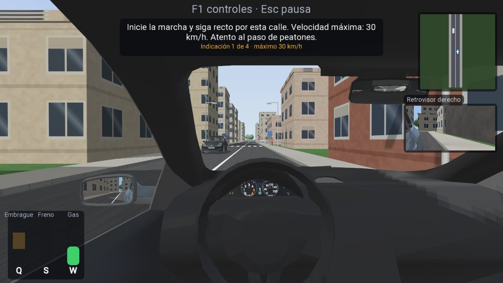
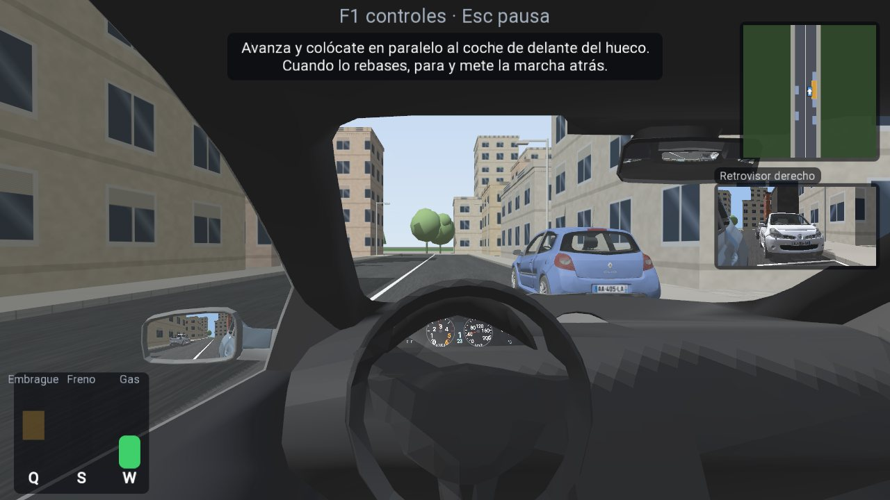
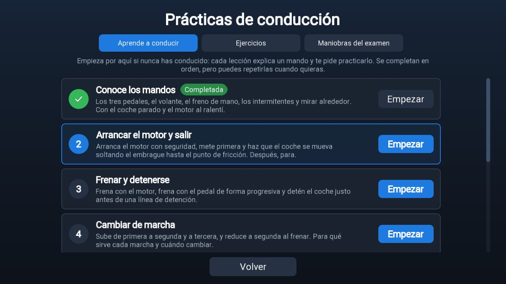
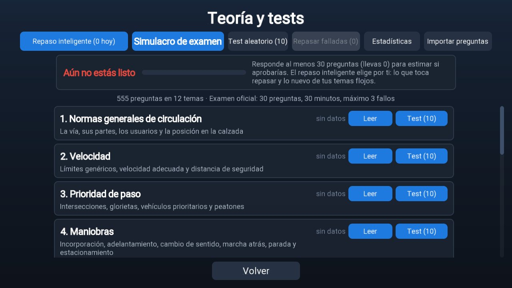
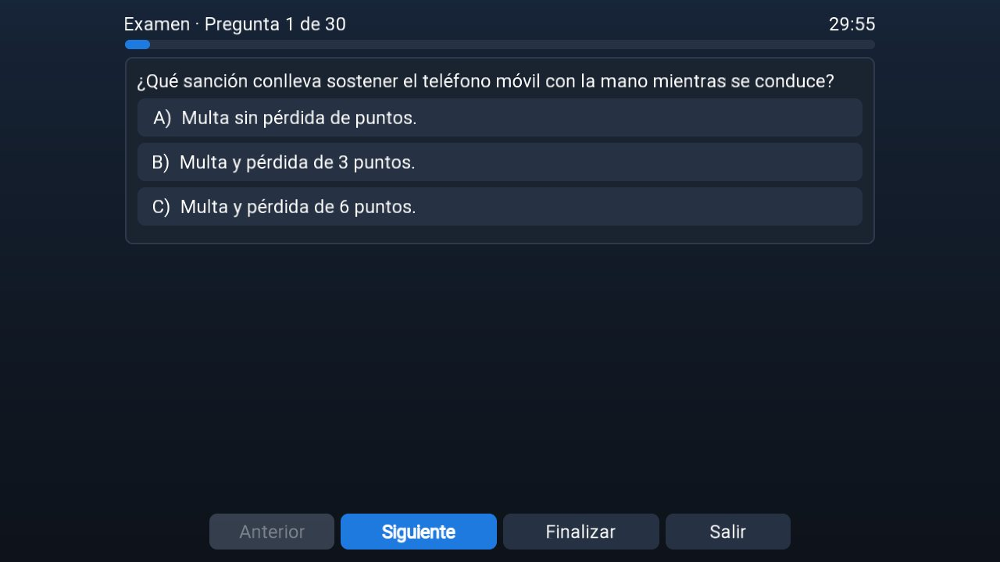

# Autoescuela

App de escritorio (Windows/Linux/macOS) y Android para preparar el permiso de conducir B en España:

- **Aprende a conducir**: 8 lecciones guiadas para quien nunca ha conducido (pedales y embrague, arrancar y salir,
  frenar, cambiar de marcha, marcha atrás, girar, qué hacer si se cala, arranque en cuesta). Cada paso explica un
  mando, lo señala en pantalla y comprueba que lo haces.

- **Simulador 3D** en primera persona de un Renault Clio III 1.5 dCi de cambio manual (embrague con punto de
  fricción, 5 marchas + R, calado, freno de mano) con físicas de bullet, para practicar las maniobras del examen
  práctico de la DGT y ejercicios de principiante, con evaluación automática de faltas (leve, deficiente,
  eliminatoria) y veredicto APTO / NO APTO.
- **Teoría y tests**: temario de 12 temas con resúmenes propios de la normativa vigente (octubre de 2026) y un banco
  de 359 preguntas propias (16 con imagen de señal) más 196 de los tests de la revista «Tráfico y Seguridad Vial» de
  la DGT (opciones barajadas en cada test), tests por tema, test aleatorio,
  simulacro del examen oficial (30 preguntas, 30 minutos, máximo 3 fallos), repaso de falladas, estadísticas e
  importación de bancos de preguntas propios (JSON/CSV).

## Capturas

| Recorrido de examen | Aparcamiento en línea |
|---|---|
|  |  |

| Aprende a conducir | Teoría y tests | Simulacro de examen |
|---|---|---|
|  |  |  |

## Lecciones

| Lección | Qué se aprende |
|---------|----------------|
| 1. Conoce los mandos | Pedales, embrague y punto de fricción, volante, intermitentes, mirar, freno de mano |
| 2. Arrancar el motor y salir | Arranque seguro, primera, punto de fricción y salir; parar sin calar |
| 3. Frenar y detenerse | Freno motor, frenada progresiva, parar antes de una línea de STOP |
| 4. Cambiar de marcha | Subir a 2.ª y 3.ª, reducir a 2.ª, cuándo cambiar |
| 5. Marcha atrás | Meterla parado, mirar atrás, retroceder con el embrague hasta una plaza |
| 6. Girar con el volante | Eslalon de conos con intermitentes |
| 7. Si se te cala el coche | Por qué se cala, provocarlo y recuperarse |
| 8. Arrancar en cuesta | Técnica del freno de mano en una pendiente del 10 % |

## Escenarios de práctica

| Escenario | Maniobra |
|-----------|----------|
| Explanada de pruebas | Conducción libre con rampa del 10 % y conos |
| Arrancar sin calar | Motor apagado: arrancar, primera y avanzar 25 m |
| Arranque en pendiente | Cuesta del 10 % con freno de mano; se mide el retroceso |
| Detención en un STOP | Parada completa antes de la línea |
| I.1 Estacionamiento en línea | Marcha atrás, ≤ 3 movimientos, ≤ 30 cm del bordillo, paralelo, y salida |
| I.2 Oblicuo / I.3 Perpendicular | Plaza en batería, centrado y alineado, ≤ 3 movimientos |
| G Marcha atrás en recta y curva | Parada a ≥ 10 m, un solo movimiento, uniforme y centrado |
| H Cambio de sentido | Calle sin salida, una sola marcha atrás, sin tocar el cono |
| Rotonda | Segunda salida con intermitente |

## Controles

Teclado: `W` gas, `S` freno, `A`/`D` dirección, `Q` embrague a fondo, `Shift izq.` medio embrague (punto de
fricción), `Espacio` freno de mano, `1-5` marchas, `R` marcha atrás, `N` punto muerto, `E`/`Z` subir/bajar,
`Intro` contacto, `←`/`→` intermitentes, botón derecho del ratón para mirar, `V` cámara (cabina / exterior /
cenital), `C` continuar y `B` paso anterior (lecciones), `P` o `Esc` pausa, `F1` controles, `F2` datos de depuración, `F3` formas de colisión, `F5` recargar `vehicle.json`,
`Retroceso` recolocar. Arriba a la derecha, un minimapa que gira con el coche.

Mando: gatillos gas y freno, `LB` embrague, stick izquierdo dirección, stick derecho mirar, `X` freno de mano,
`RB`/`A` sube, `B` baja, `Start` contacto, cruceta intermitentes, `Y` cámara.

Táctil (Android, o Ajustes → controles táctiles): volante arrastrable, pedales analógicos (la altura del dedo es el
recorrido), botones de marchas, freno de mano, llave e intermitentes.

## Stack

libGDX 1.14.2 (Java 17), gdx-bullet (físicas), gdx-gltf (modelos PBR), gdx-freetype, gdx-controllers.
Módulos `core` (toda la app), `lwjgl3` (escritorio) y `android`.

## Comandos

```
gradlew lwjgl3:run              # ejecutar en escritorio
gradlew core:test               # tests (headless: física, transmisión, evaluadores, teoría)
gradlew android:assembleDebug   # APK de depuración (android/build/outputs/apk/debug)
gradlew lwjgl3:jar              # jar ejecutable en lwjgl3/build/libs
gradlew signs                   # regenera las imágenes de señales (assets/theory/signs)
```

Opciones de desarrollo del escritorio (`--args`): `--scenario=<id>` arranca directamente en un escenario,
`--screen=theory|practice|test|exam|stats|settings`, `--script="0.5:handbrake,gear=1|1.5:throttle=0.5"` conduce
con un guion, `--shots=2,5` guarda capturas en `assets/cache/`, `--exit=6`, `--touch` fuerza los controles táctiles, `--notouch` los quita, `--screen=practice-lesson|practice-exercise|practice-exam`
abre esa pestaña de prácticas y `--eye=x,y,z` / `--fov=70` prueban la posición de los ojos en la cabina.

Android necesita `local.properties` con `sdk.dir`. Publicar: `apk-tools\publish-apk.ps1 -App Autoescuela -Release` (o sin `-Release` para la de depuración).

## Estructura

```
assets/data/vehicle.json        parámetros del coche (recarga en caliente con F5)
assets/data/scenarios/*.json    escenarios (módulos, bordillos, marcas, zonas, parámetros de la maniobra)
assets/data/temas.json          temario
assets/data/preguntas.json      banco de preguntas propio
assets/i18n/strings.properties  textos (UTF-8 sin BOM)
assets/models, assets/sounds    assets externos opcionales (ver docs/ASSETS.md)
core/.../sim                    física (bullet), transmisión, escenarios y evaluadores
core/.../theory                 repositorio, generador de tests, sesiones, estadísticas, importador
core/.../ui                     pantallas y widgets (scene2d, skin en código)
docs/                           FORMATO_PREGUNTAS.md, ASSETS.md
```

Datos del usuario (en `assets/` en escritorio, en el almacenamiento de la app en Android): `save/stats.json`,
`save/preguntas_usuario.json`, `import/` (bancos a importar), `cache/` (sonidos sintetizados y capturas).

## Documentación

- [docs/DISENO.md](docs/DISENO.md): diseño de la app (arquitectura, física, transmisión, evaluación, teoría).
- [docs/PROGRESO.md](docs/PROGRESO.md): estado por hitos, verificado, registro de cambios y pendientes.
- [docs/ASSETS.md](docs/ASSETS.md), [docs/BLENDER.md](docs/BLENDER.md): modelos 3D y sonidos.
- [docs/FORMATO_PREGUNTAS.md](docs/FORMATO_PREGUNTAS.md): formato de temas y preguntas e importación.

## Pendiente

- Sonidos reales de motor (la app los usa automáticamente al copiarlos en `assets/sounds`; ver `docs/ASSETS.md`).
- Herramienta de descarga de los tests públicos de la DGT como fixtures (la URL oficial de tests no está accesible
  por HTTP plano en este momento).
- Ejercicio de incorporación con tráfico.
